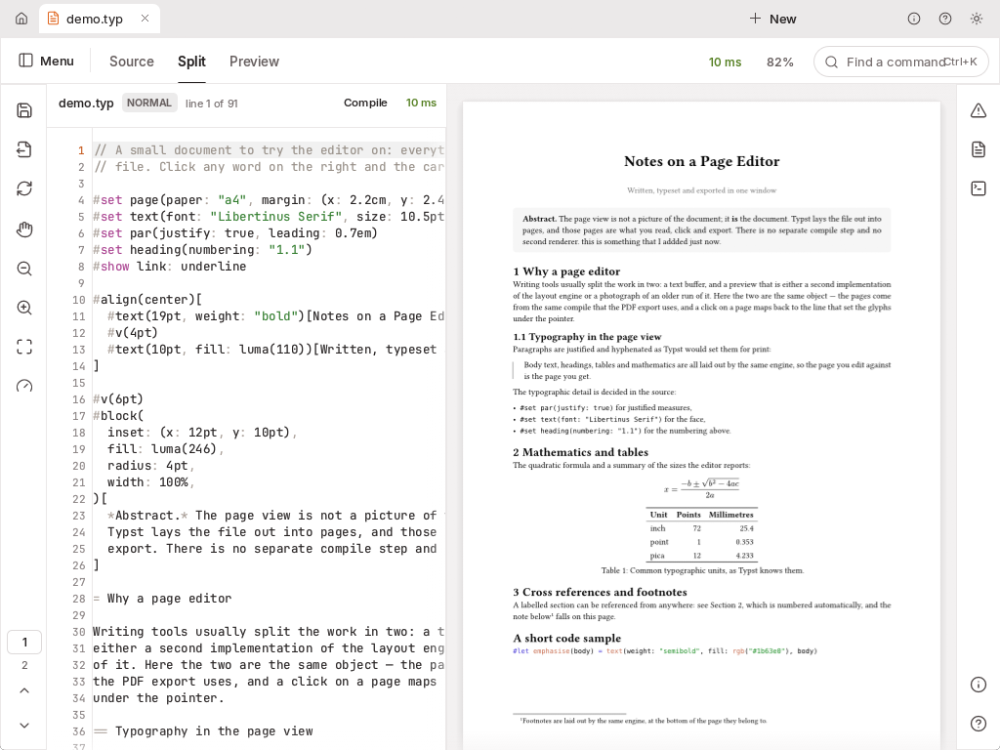
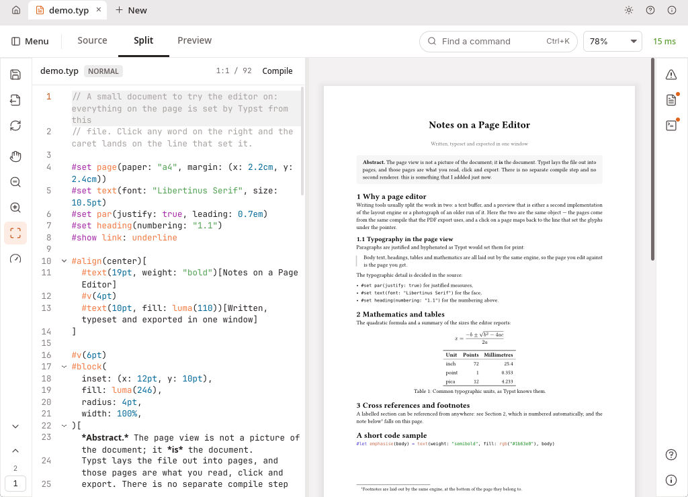
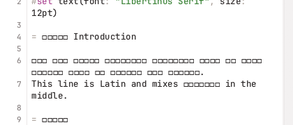
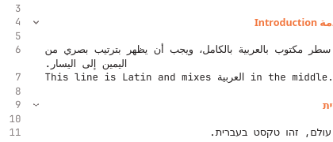

# PDF Editor

A native editor for [Typst](https://github.com/typst/typst) whose page view *is* the typeset
document: the source is on the left, the pages Typst lays out are on the right, and every
keystroke is typeset again. A click on a word in the page puts the caret on the line that set
it, and **Export PDF** writes exactly the pages on screen.

```
┌ tab strip ── ⌂ · document tabs · + New ──────────────────── theme · help · info ┐
├ mode bar ── Menu │ Source · Split · Preview ── compile · palette · zoom ────────┤
│ ┌──┐┌─ source ─────────────────┐┌── page view (typst) ──┐┌─ panel ────────────┐ │
│ │  ││ 1  #set page(...)        ││                        ││ Problems / Document│ │
│ │▐▌││ 2  #set text(...)        ││   ┌──────────────┐     ││      / Log         │ │
│ │  ││ 3                        ││   │  page 1      │     ││                    │ │
│ │  ││ 4  = Heading             ││   └──────────────┘     ││                    │ │
│ └──┘└──────────────────────────┘└────────────────────────┘└────────────────────┘ │
└───────────────────── pasteboard (gray), pages with a shadow ────────────────────┘
```

The chrome — tab strip, mode bar, tool rails, panels, pasteboard, colour palette, Inter
typeface and Lucide icons — is the `pdf-translate` app's (a sibling project on this machine),
which is PdfCraft's (`crates/ui-egui`), so the three apps read as one family. What changes is the engine: pages
come from the Typst compiler instead of from a PDF file.

## Before building this: does such an app already exist?

Checked while starting this project (November 2025). **Typst editors with a live page preview
exist and are good** — the official web app (typst.app), the desktop editors *Typstify*,
*DBV Typst Editor*, *LumiType*, *Edist* (macOS), *typster*, *Typsastra*, the Tauri-based
*Typst Editor*, and the VS Code extension with *Tinymist*. **A PDF editor built on Typst does
not exist**, because Typst cannot read a PDF: it is a typesetting engine, not a PDF editor.
Any "edit the PDF with Typst" tool therefore has to *reconstruct* Typst source from a PDF,
which is a different (research) problem.

So this app is the first kind: a Typst editor whose page view is the real typeset output,
built on top of the `pdf-translate` shell. If what you want is instead "open a PDF, get an
editable Typst document", that is a converter, and it belongs in front of this editor — the
page view, click-to-source and export here are what it would target.

The only Rust integration that renders Typst into egui before this one is
[`typst-egui`](https://github.com/mattfbacon/typst-egui), which describes itself as "a very
restricted proof-of-concept". This app does not use it: it drives `typst` directly, so pages
are compiled once and rasterised at whatever zoom the view needs.

## What it does

* **The page view is the compile.** One compile produces the pages you read *and* the PDF you
  export. There is no separate preview renderer, no screenshot of an older run.
* **Typeset when you stop, not on every key.** Edits are compiled once typing has paused for
  0.6 s (Ctrl+R typesets at once), on a background thread — the page view settles after a
  sentence rather than following every word. While a new compile runs, the pages already on
  screen stay there (stretched, if their size changed) until the new rasters are ready, so the
  view never blanks or flickers mid-word. When the source does not compile, the last good pages
  stay on screen and a banner says why.
* **Click a page, land in the source.** Every text run in the layout carries the span it was
  set from, so a click maps page point → glyph → source line. The caret goes there, the line
  is marked in the gutter, and the view switches out of *Preview* so you can see it. Hovering
  a word marks the run a click would jump to.
* **Vim motions in the source pane.** Normal, Insert and Visual modes with counts, operators,
  text objects, `u`/`Ctrl+R` and a command line — see below.
* **Soft wrap and a split you set.** Long lines wrap at the pane's width (one line number per
  logical line, on its first row; the current-line band and diagnostic squiggles follow the
  wrapped rows). The divider between the source and the pages is draggable, as is the edge of
  the Problems/Document/Log panel, and both widths are remembered. With *Fit to width* the
  pages re-fit as the band changes, until you pick a zoom yourself.
* **Syntax colours from Typst's own parser.** The editor does not pattern-match markup: it
  parses the buffer with `typst::syntax::parse` and colours the leaves (keywords, strings,
  numbers, math, labels, markers), so the highlighting cannot drift from the language.
* **Problems, in the text and in a list.** The compile's errors and warnings are underlined
  where they happen: the line is washed, the offending span carries a squiggle, and the gutter
  turns the line number red (error) or amber (warning) with a tick beside it. The Problems panel
  lists the same diagnostics with file:line:column and hints; a click puts the caret on the
  exact line *and* column, and the header reads `line:column / lines`. Marks disappear on the
  first keystroke and come back with the next compile, so they never point at stale offsets.
* **Tabs, sessions and PDF export.** Each document opens in its own tab (`Ctrl+Tab` switches,
  the `x` closes, unsaved changes are confirmed before closing); the tabs and the page each
  was on are restored at the next start. **Export PDF** (`Ctrl+E`) writes the compiled
  document; **Save** (`Ctrl+S`) writes the source.
* **The page view behaves like a reader.** Zoom with `Ctrl` + wheel around the pointer, the
  standard zoom steps, *Actual size*, *Fit to width*, panning, a two-page spread when the band
  is wide enough, the page box and page buttons in the rail, `Page Down`/`Up`, `Home`/`End`.
* **A document to try it on.** [`doc/demo.typ`](doc/demo.typ) exercises headings, an abstract
  block, math, a table with a caption, a cross-reference, a footnote and a code block.



## Vim motions

The source pane is modal, like Vim. It starts in **Normal** mode: press `i`, `a`, `o` … to type
and `Esc` to come back. The mode and any half-typed command are shown next to the file name
(`NORMAL`, `INSERT`, `VISUAL`, `VISUAL LINE`, `COMMAND`, plus things like `2d` or `ciw`).

| | |
| --- | --- |
| Modes | `i I a A o O` insert; `v` character-wise and `V` line-wise Visual; `:` command line; `Esc` (or `Ctrl+[`) back to Normal |
| Motions | `h j k l`, `w W b B e E`, `0 ^ $`, `gg`/`G`/`{count}G`, `{`/`}` paragraphs, `+`/`-`/`_`, the column motion, `f t F T` with `;` `,` |
| Counts | before a motion, an operator or an insert command (`3j`, `2dd`, `5x`, `2p`, `3G`) |
| Operators | `d c y > <`, doubled for whole lines (`dd cc yy >> <<`), with motions (`dw`, `d$`, `dfx`, `d}`) and text objects (`iw aw iW aW`, `i" a"`, `i' a'`, `` i` a` ``, `i( a(`, `i[ a[`, `i{ a{`) |
| Shortcuts | `x X s S D C Y r ~ J`; `p`/`P` with the unnamed register |
| Visual | `d c y x s ~ > < J p` on the selection, `o` to swap ends, `v`/`V` to toggle |
| Search | `/pattern` then `n` / `N` (wraps around) |
| Command line | `:w` write, `:wq` / `:x` write and close, `:q` / `:q!` close the tab, `:e <file>` open, `:comp` compile, `:<n>` go to line |
| Undo | `u` and `Ctrl+R`; one insert session (or one change + its typing) is one step |

Deliberately not implemented, and warned about on the status line when pressed: marks
(`m`, `'`), macros (`q`), block Visual (`Ctrl+V`), `.` repeat, named registers, `zz`/`zt`/`zb`
and folding. `Ctrl+D`/`Ctrl+U`/`Ctrl+F`/`Ctrl+B` move the cursor by lines (the view follows)
rather than scrolling under a still cursor.

A note in the header describes the command that just ran and is retired by the next key press,
the way Vim's status line clears itself; a `:w` also drops its *writing…* note as soon as the
file is on disk, where the toast reports the result.

The bindings can be switched off from **Menu ▸ Vim bindings** or the command palette
(*Vim bindings: on/off*); the choice is remembered. With them off the pane is an ordinary text
editor and the badge disappears.

## Requirements

* Rust with a toolchain at least `1.92` (the `typst` crate's `rust-version`). This machine runs
  a nightly `1.102`.
* Fonts: Typst's embedded faces (Libertinus Serif, New Computer Modern, DejaVu Sans Mono) come
  with the build; everything installed on the machine is scanned at startup as well, so
  `#set text(font: "…")` can name any installed family. The first scan takes a moment — the
  mode bar says *loading fonts…* until it is done.
* No network at runtime. `#import "@preview/…"` resolves from the packages already installed
  on the machine (`TYPST_PACKAGE_PATH`, then Typst's data and cache directories); there is no
  downloader here (see *Notes and limitations*).

## Build & run

The workspace builds two windows over the same engine and the same vim machine:

| binary | window layer | source editor |
| --- | --- | --- |
| `pdf-editor` | egui/eframe 0.36 | our own pane (`crates/egui-app/src/editor.rs`) |
| `pdf-editor-iced` | iced 0.14 | `typst-iced-editor` 0.2 (cosmic-text) |

```bash
cd ~/llm/pdf-editor
cargo run --release -p pdf-editor      -- doc/demo.typ   # the egui build
cargo run --release -p pdf-editor-iced -- doc/demo.typ   # the iced build
```

Both read the same `doc/demo.typ`, compile it with the same thread, render the same pages, and
share the settings file, so switching between them is safe. The iced build is the one to use if
the source contains bidirectional or complex-script text — see
[Two windows, one engine](#two-windows-one-engine).

A `.typ` file named on the command line opens in a tab; without an argument the documents of
the last session are reopened (new, never-saved documents are not restored). **Open…**
(`Ctrl+O`) picks another; **New** (`Ctrl+N`) starts a document from a small template.

### Debug helpers (no UI)

The helpers live in the egui binary (`pdf-editor`); the iced one is window-only.

```bash
# compile a file and write the PDF (defaults to the file's own name)
pdf-editor --compile doc/demo.typ /tmp/demo.pdf

# compile and list errors and warnings with line/column
pdf-editor --check doc/demo.typ

# list pages, their size, and the click-to-source runs indexed for each
pdf-editor --pages doc/demo.typ
```

### Test hooks

Native file dialogs cannot be driven headlessly, so a save or export can be pointed at a
folder instead:

```bash
PDF_EDITOR_SAVE_DIR=/tmp/out PDF_EDITOR_EXPORT_DIR=/tmp/out pdf-editor doc/demo.typ
```

Then `Ctrl+S` writes `/tmp/out/demo.typ` and `Ctrl+E` writes `/tmp/out/demo.pdf` without
opening a dialog. `PDF_EDITOR_SETTINGS=/tmp/settings.json` moves the settings file (both
builds honour it), which is what the headless screenshots use.

## Two windows, one engine

The window layer is a shell over `crates/core`; nothing in the engine, the page geometry or
the vim state machine knows which toolkit drew it. What the two shells buy:

| | egui build | iced build |
| --- | --- | --- |
| Source text shaping | harfrust, no bidi: an Arabic or Hebrew line is drawn left-to-right and the monospace face may have no glyphs for it at all (boxes). | cosmic-text: bidi, Arabic joining, Hebrew, emoji. The same line renders in visual order, exactly as the page does. |
| Modal editing | `crates/egui-app/src/vim_input.rs` takes the frame's event queue and filters it before `TextEdit` sees it. | `CodeEditor::key_binding` hands every press to `vim` in Normal/Visual/Command mode, and falls back to the editor's own bindings in Insert mode. |
| Caret placement from a page click | line only (`engine::line_at`). | line **and** column (`engine::position_at`, fed by the per-glyph source byte the compile indexes). |
| Chrome | PdfCraft's immediate-mode widgets. | the same tokens as iced styles (`container`, `button`, `scrollable`, `svg` icons). |
| Accessibility | accesskit, shipped by eframe. | none (iced has no accesskit yet). |

The iced build reached parity on the visible features: tab strip, mode bar with the view tabs,
palette and zoom, both rails, the Problems/Document/Log panels, the draggable source/pages
split and side-panel grip, toasts, the shortcuts and unsaved-changes overlays, fit-to-width,
zoom anchoring (`Ctrl` + wheel included), spread, pan, raster refresh, export, session restore
and the same vim subset.

Its window follows one small design system: a single `theme::Tokens` (colours, radii, metrics,
the Inter/JetBrains Mono faces), one `widgets.rs` vocabulary every control is built from, and
one keyboard path — `Esc` closes exactly one layer (palette → shortcuts → dialog), an open
overlay swallows global shortcuts, icon-only controls carry tooltips, unavailable actions are
`on_press_maybe(None)` rather than silently dead, closed panels with content get a rail dot,
and panels share one 40 px header + scrolling body. The tab strip, mode bar, rails and panels
are pure projections of `App`; floating layers are siblings in a `Stack`, so a palette or a
dialog never reflows the document behind it.

Two differences remain: iced exposes no widget id for the code editor, so the source pane takes
the keyboard on the first click rather than on launch; and there is no accessibility tree.

The egui build stays the default: it is the one with the debug CLI and accessibility.

The same document in the iced build (`doc/demo.typ`):



The reason the port was worth its cost is visible with a bidirectional document. The egui
source pane draws the Arabic line as boxes in logical order; the iced pane shapes and orders
it. The typeset pages are identical in both, because they come from the same compile.

| egui | iced |
| --- | --- |
|  |  |

## Chrome and shortcuts

The tab strip holds one tab per document and the **New** action; the mode bar has the
**Menu**, the view tabs (*Source · Split · Preview*), the compile status (click it for
*Problems*) in front of the command palette, and the zoom control. The compile time changes on
every compile, so it sits in a fixed-width slot and never shifts its neighbours. The left rail
has save, export, compile, pan and the zoom tools, with the page box, page count and page
buttons at the bottom. The right rail toggles the panels and holds the theme and help buttons.

| Keys | |
| --- | --- |
| `Ctrl+N` / `Ctrl+O` | new document / open |
| `Ctrl+S` / `Ctrl+Shift+S` | save / save as |
| `Ctrl+E` | export PDF |
| `Ctrl+R`, `Ctrl+Enter` | compile now |
| `Ctrl+W` | close the tab |
| `Ctrl+Tab` / `Ctrl+Shift+Tab` | next / previous tab |
| `Ctrl+K` | command palette |
| `Ctrl++` / `Ctrl+−` / `Ctrl+0` / `Ctrl+2` | zoom in / out / 100% / fit to width |
| `Ctrl` + wheel | zoom around the pointer |
| click a page | go to the line that set the text |
| `Page Down` / `Page Up`, `Home` / `End` | next / previous, first / last page (when no text field has the keyboard) |

The page-keys give way to the source editor while the pointer is over it, so `Page Down`
scrolls text there and turns pages everywhere else.

## How it is built

| file | role |
| --- | --- |
| `crates/core/src/engine/world.rs` | the `typst::World`: the buffer as main source, includes from the document's folder, fonts, date |
| `crates/core/src/engine/compile.rs` | the compile thread (compile, diagnostics, glyph index for click-to-source, PDF export) |
| `crates/core/src/engine/mod.rs` | the raster pool that turns compiled pages into textures at the requested zoom |
| `crates/core/src/vim.rs` | the modal layer: modes, motions, operators, text objects, registers, undo, search, command line |
| `crates/core/src/source.rs` | the `Source` trait and `Edit` the modal layer edits through |
| `crates/core/src/document.rs` | settings and session, theme kinds, diagnostic → mark conversion, path helpers |
| `crates/egui-app/src/main.rs` | entry point and the debug CLI |
| `crates/egui-app/src/app.rs` | the egui window: chrome, tabs, page stack, panels, click-to-source, session, export |
| `crates/egui-app/src/editor.rs` | the egui source pane: buffer, syntax colours, gutter, current line, go-to-line, command line |
| `crates/egui-app/src/vim_input.rs` | the egui event filter that feeds the shared vim machine |
| `crates/egui-app/src/theme.rs`, `icons.rs`, `widgets.rs` | PdfCraft's design tokens, Lucide icons and chrome widgets |
| `crates/iced-app/src/app.rs` | the iced application: `Message`/`update`/`view`, chrome, tabs, page stack, panels, overlays, keyboard priority |
| `crates/iced-app/src/widgets.rs` | the one widget vocabulary: icon/ghost/pill buttons, tabs, search box, list row, panel shell, scrollable, tooltip, scrim, toast, empty state |
| `crates/iced-app/src/pages.rs` | page layout, current page, click → `(line, column)` |
| `crates/iced-app/src/vim.rs` | the vim adapter on `key_binding`/`Action` and the text diff |
| `crates/iced-app/src/theme.rs`, `icons.rs` | the same tokens as iced styles and SVG icons, chrome metrics and the Inter/JetBrains Mono faces |

**Compiling.** `typst::compile::<PagedDocument>` runs on a dedicated thread that owns the
`PagedDocument` and the last word: when a newer buffer is queued while a compile runs, the
buffers in between are dropped. The result is an `Arc<PagedDocument>` plus, per page, its size
in points and a list of text runs with the source line each came from. Errors keep the old
pages; warnings are shown but do not stop the render.

**Click-to-source.** The compile thread walks each page's frame items (groups included, with
their transform applied), and for every glyph asks the world for the byte range of its span.
Glyphs from the same line that sit on the same row are merged into one rectangle; the index is
`(rect in points, line)`. A click divides by the zoom, asks for the nearest rect within 6 pt,
and moves the caret. Text from an included file has no line in the buffer, so clicking it does
nothing (the page still shows it).

**Rasterising.** A pool of threads takes `(page, scale, tag)` requests from the UI each frame,
in order of urgency (the page in view first), renders the page with `typst-render` at the
requested scale (capped at 3× device pixels per point and 24 Mpx per page), and hands the RGBA
back: egui uploads it as a texture, iced as an `image::Handle`. A request whose page left the
screen is replaced, not queued.

**Export.** The same `PagedDocument` is handed to the compile thread, which writes it with
`typst-pdf` — so the PDF cannot differ from what was on screen.

**Two front-ends.** The engine (`world`, `compile`, raster pool), the vim machine and the
document model live in `crates/core`; the egui and iced binaries are shells over it. The vim
machine speaks byte offsets into a plain `String` and a toolkit-neutral `Key`, so the same
1.8k lines of motions/operators/text objects run in both. The iced shell turns each command's
mutation into the difference between the old and the new text and applies it as one
`Action::Replace`, which keeps the editor's syntax tree, history and scroll story intact.
The plan, the inventory and the acceptance tests are in [doc/iced-port.md](doc/iced-port.md);
the "Implemented" section there records what landed and where it deviates.

## Notes and limitations

* **A Typst engine, not a PDF importer.** Opening a PDF and editing it in place is not
  something Typst can do; this app edits `.typ` files. A PDF → Typst converter in front of it
  is a separate project.
* **No package downloader.** `@preview/…` imports resolve from the packages installed on the
  machine — `$TYPST_PACKAGE_PATH`, then `~/.local/share/typst/packages` and
  `~/.cache/typst/packages`, the same order `typst compile` looks in — and fail otherwise, so
  `typst compile` (or `typst init @preview/…`) once is what installs them. Everything else —
  `#include`, `#import` of local files, `#read`, images — resolves relative to the document's
  folder, as `typst compile` does.
* **One file per tab is the main source.** An included file can be read and typeset, but
  editing it means opening it in its own tab (and its edits are not noticed by the including
  document until it is compiled again).
* **`Tab` indents inside the source** instead of moving focus; there is no block indent
  selection beyond Vim's `>`/`<`.
* **Raster scale is capped.** At very high zoom the page is stretched from a 3× raster
  instead of being re-rendered per tile, which is cheaper and blurrier than PdfCraft's tiling.
  Pages are also rendered whole, so a poster-sized page at high zoom costs a large texture.
* **Empty IME pre-edit events are dropped.** Some compositors (KWin's text-input protocol, seen
  here) send a "pre-edit: nothing" event with *every* frame while a text field has focus, and
  egui repaints immediately whenever the frame carries any event — a self-sustaining 60 fps
  redraw loop that made the source pane shimmer (and cost ~25% CPU on this box). The window
  filters those empty pre-edits before any widget sees them; a real pre-edit (IME composition)
  is passed through untouched. Relatedly, egui rewrites the caret range it is given (it sets
  `prefer_next_row`), so the pane now only stores the range when the caret actually moved -
  storing it every frame looked like a selection change on every frame, which made the widget
  re-scroll to the caret on every frame.
* **The text keeps its colours on the frame you type in.** The pane lays the text out twice per
  frame in the worst case — once before the widget (to know the content's size and where the
  caret sits) and once by the widget itself, which sees the text *after* this frame's keystroke.
  It used to hand the widget the galley it had laid out, so on every keystroke the widget was
  given a stale layout and drew the whole buffer in one plain colour for a frame: a visible
  flash per character. Now the widget always lays out the buffer it is given, and the current
  line and diagnostic washes are painted from *that* layout through shape slots reserved
  before the text. (egui has no partial redraw: the window is repainted as a whole, so the fix
  is to keep each frame's work correct and cheap rather than to repaint one line.) In Insert
  mode the widget also does the scrolling; the pane no longer scrolls as well.
* **Vim is a subset.** See the table above: no marks, macros, block Visual, `.` repeat or named
  registers. Undo snapshots copy the whole buffer, so a very large document pays for `u`; the
  history keeps the last 400 changes.
* **Click-to-source granularity differs by shell.** The egui build lands on the start of the
  source line that set the glyphs; the iced build indexes individual glyphs and lands on the
  line **and column** under the pointer.
* **The session and settings live in one JSON file**, `${XDG_CONFIG_HOME:-~/.config}/pdf-editor/settings.json`
  (or `PDF_EDITOR_SETTINGS`), shared by both builds: zoom, theme, view, split and panel widths,
  vim on/off and the reopened tabs. The egui build no longer uses eframe's storage.
* **New documents live in the working directory.** `Ctrl+N` names the buffer
  `untitled.typ` (or `untitled-2.typ`, …) next to the process; until it is saved it is not
  restored in the next session.
